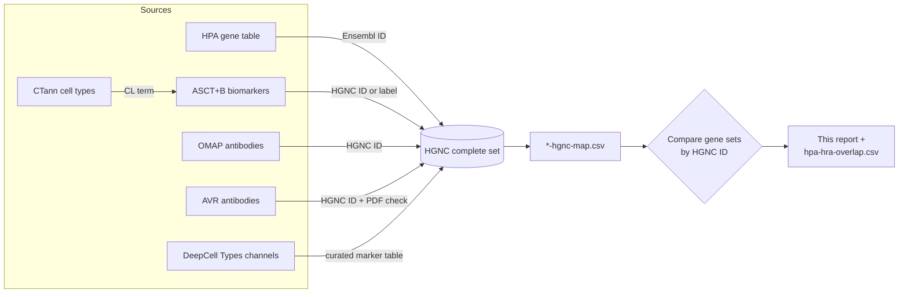
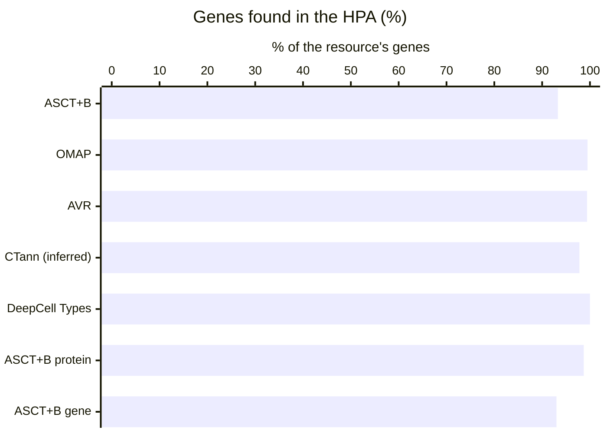
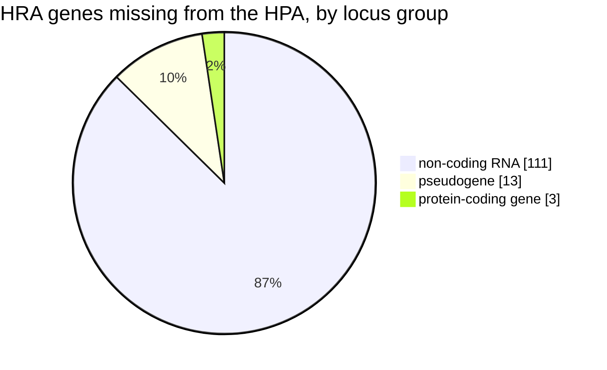
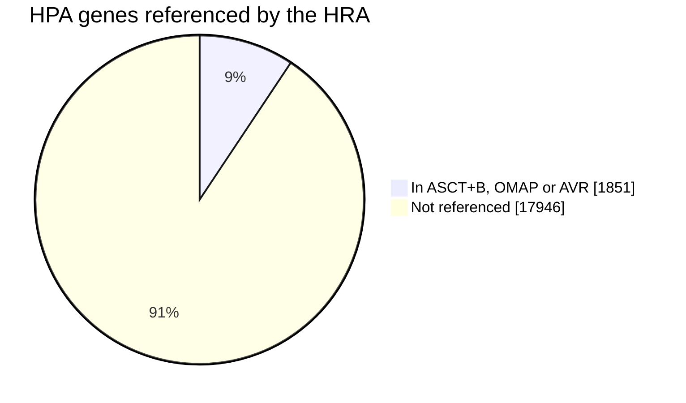
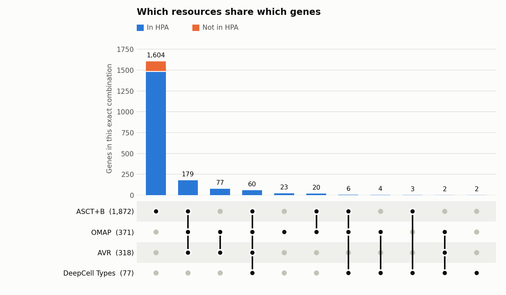
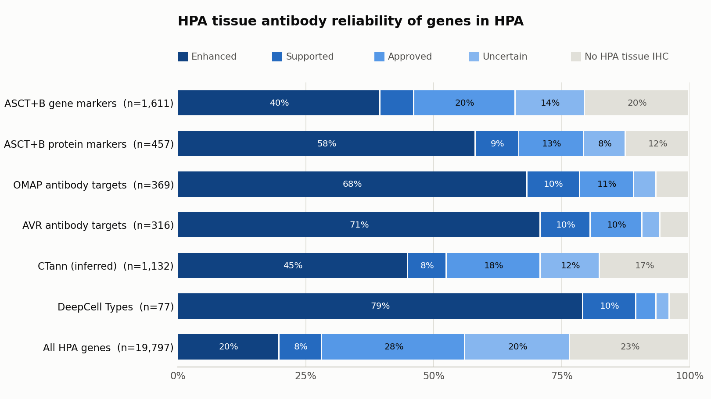

# HPA × HRA protein/gene overlap report

_Part of [cns-iu/hra-hpa-overlap-report](https://github.com/cns-iu/hra-hpa-overlap-report). See the [project README](../README.md) for setup and the per-source gene maps._

_Generated 2026-11-05 by [`src/build_overlap_report.py`](../src/build_overlap_report.py) from the maps in the [`output/`](../output/) folder. Genes are compared by HGNC ID. Unless stated otherwise, numbers use the **corrected** gene sets (suggested fixes applied; see [Sensitivity](#sensitivity-to-data-quality-fixes))._

## Executive summary

- **The HPA covers 93.6% of the genes the HRA references.** 1,851 of the 1,978 distinct genes named in ASCT+B, OMAP and AVR are in the HPA gene table.
- **Almost every protein-level marker is in the HPA.** ASCT+B protein markers: 98.7% (457/463); OMAP antibody targets: 99.5%; AVR antibody targets: 99.4%. ASCT+B gene (RNA) markers: 93.0%.
- **The 127 HRA genes missing from the HPA are mostly not protein-coding.** 124 of them are non-coding RNAs, pseudogenes or other non-protein loci (non-coding RNA: 111, pseudogene: 13, protein-coding gene: 3). The HPA only covers protein-coding genes, so this gap is expected, and it comes almost entirely from ASCT+B gene (RNA) markers. Only 3 are protein-coding (TRA, TRD, TRG). All of these are HGNC locus records with no single Ensembl gene (e.g. T-cell receptor loci), so the HPA cannot list them as genes.
- **The HRA uses 9.3% of the HPA.** Only 1,851 of the 19,797 HPA genes with an HGNC ID appear in any HRA resource. That leaves a large pool of protein-coding genes with HPA evidence that could become HRA biomarkers.
- **The HRA's antibody targets have unusually strong HPA antibody support.** 78.6% of OMAP/AVR targets in the HPA have *Enhanced* or *Supported* HPA tissue staining, against 28.2% of all HPA genes.
- **CTann gene sets are inferred, not stated.** CTann crosswalks only reference cell types. Their 1,157 genes come from ASCT+B, of which 97.8% are in the HPA.
- **The data-quality fixes barely move the headline numbers** (HRA coverage 93.6% as given, 93.6% corrected, 93.7% without flagged rows). They do matter for individual genes: see [`review-items.csv`](../output/review-items.csv).

|  | Distinct genes | In HPA | % in HPA |
| --- | ---: | ---: | ---: |
| **ASCT+B** | 1,872 | 1,746 | 93.3% |
| **OMAP** | 371 | 369 | 99.5% |
| **AVR** | 318 | 316 | 99.4% |
| **CTann (inferred)** | 1,157 | 1,132 | 97.8% |
| **DeepCell Types** | 77 | 77 | 100.0% |
| **HRA union** (ASCT+B ∪ OMAP ∪ AVR) | 1,978 | 1,851 | 93.6% |
| **HPA** (genes with an HGNC ID) | 19,797 | – | – |

## How the comparison works

- **A gene** is an HGNC ID. Multi-gene records count every gene they name: pan-cytokeratin, for example, counts each keratin it detects.
- **The HPA set** is the 19,797 HPA genes that resolve to an HGNC ID. The 357 HPA entries without an HGNC record cannot overlap anything.
- **The HRA union** is ASCT+B ∪ OMAP ∪ AVR. CTann is left out because its genes are a subset of ASCT+B by construction. DeepCell Types is not an HRA resource and is shown for comparison.

## How much of each HRA resource is in the HPA

ASCT+B by biomarker type (one gene can be both a gene and a protein marker):

| Biomarker type | Distinct genes | In HPA | % in HPA |
| --- | ---: | ---: | ---: |
| gene | 1,732 | 1,611 | 93.0% |
| protein | 463 | 457 | 98.7% |
| metabolites | 5 | 5 | 100.0% |
| proteoforms | 3 | 3 | 100.0% |
| lipids | 2 | 2 | 100.0% |

## HRA genes that are not in the HPA

127 HRA genes are missing from the HPA, grouped below by HGNC locus group. The HPA profiles protein-coding genes, so non-coding RNAs and pseudogenes are expected to be missing. Only 3 are protein-coding (TRA, TRD, TRG). All of these are HGNC locus records with no single Ensembl gene (e.g. T-cell receptor loci), so the HPA cannot list them as genes.

| Locus group | Genes |
| --- | ---: |
| non-coding RNA | 111 |
| pseudogene | 13 |
| protein-coding gene | 3 |

Most-used missing genes (by number of ASCT+B biomarker rows):

| Gene | HGNC ID | Locus type | ASCT+B rows | Also in |
| --- | --- | --- | ---: | --- |
| OTX2-AS1 | HGNC:43906 | RNA, long non-coding | 10 | – |
| LINC02306 | HGNC:53225 | RNA, long non-coding | 8 | – |
| LINC01798 | HGNC:52588 | RNA, long non-coding | 7 | – |
| OBI1-AS1 | HGNC:42700 | RNA, long non-coding | 7 | – |
| IFNG-AS1 | HGNC:43910 | RNA, long non-coding | 6 | – |
| LINC01608 | HGNC:51662 | RNA, long non-coding | 6 | – |
| LINC02552 | HGNC:53587 | RNA, long non-coding | 6 | – |
| NPSR1-AS1 | HGNC:22128 | RNA, long non-coding | 6 | – |
| LINC00326 | HGNC:41926 | RNA, long non-coding | 5 | – |
| LINC01821 | HGNC:52626 | RNA, long non-coding | 5 | – |
| LINC02055 | HGNC:52895 | RNA, long non-coding | 5 | – |
| LINC02196 | HGNC:53062 | RNA, long non-coding | 5 | – |
| LINC02263 | HGNC:53175 | RNA, long non-coding | 5 | – |
| NR2F2-AS1 | HGNC:44222 | RNA, long non-coding | 5 | – |
| FER1L6-AS2 | HGNC:26534 | RNA, long non-coding | 4 | – |

## How much of the HPA the HRA uses

| Resource | HPA genes referenced | % of HPA |
| --- | ---: | ---: |
| ASCT+B | 1,746 | 8.8% |
| OMAP | 369 | 1.9% |
| AVR | 316 | 1.6% |
| CTann (inferred) | 1,132 | 5.7% |
| DeepCell Types | 77 | 0.4% |
| **HRA union** | **1,851** | **9.3%** |

## Which resources share which genes

Each column is one exact combination of resources, e.g. genes in ASCT+B and OMAP but in neither AVR nor DeepCell. Bars are split by HPA membership. CTann is left out because its genes are a subset of ASCT+B.

<picture>
  <source media="(prefers-color-scheme: dark)" srcset="figures/upset-dark.png">
  
</picture>

| Combination | Genes | In HPA | Not in HPA | Most-used examples |
| --- | ---: | ---: | ---: | --- |
| ASCT+B | 1,604 | 1,479 | 125 | TEK, TIE1, TAGLN, DDR2, MYOCD, AIFM2 … |
| ASCT+B + OMAP + AVR | 179 | 178 | 1 | CDH5, CNN1, UCHL1, CD5, EPCAM, PDGFRB … |
| OMAP + AVR | 77 | 76 | 1 | KRT16, SYNPO, ACTB, PARP1, CDKN2A, DNALI1 … |
| ASCT+B + OMAP + AVR + DeepCell Types | 60 | 60 | 0 | PECAM1, ACTA2, CD34, CD36, CD4, CD8A … |
| OMAP | 23 | 23 | 0 | KRT2, ATP1A3, ATP1A4, CDH10, CDH11, CDH15 … |
| ASCT+B + OMAP | 20 | 20 | 0 | PDGFRA, ACTG2, OGN, KRT18, KRT4, KRT3 … |
| ASCT+B + OMAP + DeepCell Types | 6 | 6 | 0 | HLA-DRB1, KRT6A, HLA-B, HLA-C, KRT17, COL4A2 |
| OMAP + DeepCell Types | 4 | 4 | 0 | KRT6B, KRT6C, CEACAM5, CEACAM6 |
| ASCT+B + DeepCell Types | 3 | 3 | 0 | CD3G, CD8B, FCGR3B |
| OMAP + AVR + DeepCell Types | 2 | 2 | 0 | CEACAM1, LAG3 |
| DeepCell Types | 2 | 2 | 0 | CD63, CEACAM3 |

- 106 OMAP/AVR antibody targets are **not** ASCT+B biomarkers. They may be candidates to add to the ASCT+B tables.
- 1,482 ASCT+B genes in the HPA have no OMAP/AVR antibody. These could be candidates for new antibody panels, especially those with strong HPA antibody support (see the gene table).

## HPA antibody evidence for HRA genes

The HPA rates its tissue-staining (IHC) antibodies as *Enhanced*, *Supported*, *Approved* or *Uncertain*. The chart compares those ratings for each HRA resource's genes (in the HPA) against all HPA genes.

<picture>
  <source media="(prefers-color-scheme: dark)" srcset="figures/hpa-reliability-dark.png">
  
</picture>

| Gene set | Enhanced | Supported | Approved | Uncertain | No HPA tissue IHC | n |
| --- | ---: | ---: | ---: | ---: | ---: | ---: |
| ASCT+B gene markers | 39.6% | 6.6% | 19.8% | 13.6% | 20.4% | 1,611 |
| ASCT+B protein markers | 58.2% | 8.5% | 12.7% | 8.1% | 12.5% | 457 |
| OMAP antibody targets | 68.3% | 10.3% | 10.6% | 4.3% | 6.5% | 369 |
| AVR antibody targets | 70.9% | 9.8% | 10.1% | 3.5% | 5.7% | 316 |
| CTann (inferred) | 45.0% | 7.6% | 18.4% | 11.6% | 17.5% | 1,132 |
| DeepCell Types | 79.2% | 10.4% | 3.9% | 2.6% | 3.9% | 77 |
| All HPA genes | 19.9% | 8.4% | 27.9% | 20.5% | 23.3% | 19,797 |

358 of the 369 OMAP/AVR targets in the HPA have at least one HPA antibody listed, so independent HPA staining is available to cross-check most HRA antibody panels.

### HPA protein evidence level

| HPA evidence | HRA genes | % of HRA genes in HPA | % of all HPA |
| --- | ---: | ---: | ---: |
| Evidence at protein level | 1,831 | 98.9% | 93.3% |
| Evidence at transcript level | 20 | 1.1% | 5.6% |
| No human protein/transcript evidence | 0 | 0.0% | 1.1% |

## What kinds of proteins the HRA uses

These are HPA protein classes for HRA genes in the HPA, compared with all HPA genes. Enrichment above 1× means the class is over-represented in the HRA. A gene can belong to several classes.

| HPA protein class | HRA genes | % of HRA genes | % of all HPA | Enrichment |
| --- | ---: | ---: | ---: | ---: |
| Predicted intracellular proteins | 1,261 | 68.1% | 78.8% | 0.9× |
| Predicted membrane proteins | 726 | 39.2% | 27.8% | 1.4× |
| Disease related genes | 726 | 39.2% | 24.8% | 1.6× |
| Human disease related genes | 722 | 39.0% | 23.0% | 1.7× |
| Plasma proteins | 649 | 35.1% | 18.9% | 1.9× |
| Predicted secreted proteins | 464 | 25.1% | 9.6% | 2.6× |
| Cancer-related genes | 428 | 23.1% | 8.4% | 2.7× |
| Transporters | 319 | 17.2% | 10.8% | 1.6× |
| Enzymes | 312 | 16.9% | 19.1% | 0.9× |
| Metabolic proteins | 280 | 15.1% | 14.6% | 1.0× |
| FDA approved drug targets | 254 | 13.7% | 4.3% | 3.2× |
| CD markers | 209 | 11.3% | 1.9% | 5.8× |
| Transcription factors | 194 | 10.5% | 7.5% | 1.4× |
| Potential drug targets | 190 | 10.3% | 8.9% | 1.2× |

## Sensitivity to data-quality fixes

The maps flag records that look wrong (see [`review-items.csv`](../output/review-items.csv)). The table shows genes in the HPA / distinct genes (% in HPA) for each way of handling them:

- **Given:** genes exactly as each map resolved them.
- **Corrected:** rows with a `suggested_hgnc_symbol` use the suggested gene. Used everywhere else in this report.
- **Confident:** every row flagged `needs_review` is dropped.

| Resource | Given | Corrected | Confident |
| --- | ---: | ---: | ---: |
| ASCT+B | 1,745 / 1,871 (93.3%) | 1,746 / 1,872 (93.3%) | 1,684 / 1,803 (93.4%) |
| OMAP | 373 / 374 (99.7%) | 369 / 371 (99.5%) | 363 / 364 (99.7%) |
| AVR | 318 / 319 (99.7%) | 316 / 318 (99.4%) | 298 / 299 (99.7%) |
| CTann (inferred) | 1,132 / 1,157 (97.8%) | 1,132 / 1,157 (97.8%) | 1,103 / 1,124 (98.1%) |
| DeepCell Types | 77 / 77 (100.0%) | 77 / 77 (100.0%) | 52 / 52 (100.0%) |
| **HRA union** | **1,854 / 1,981 (93.6%)** | **1,851 / 1,978 (93.6%)** | **1,792 / 1,912 (93.7%)** |

Corrections add 2 genes to the HRA union (CASP3, S100P) and remove 5 that were only present because of an error (ATP1B3, ATP6V1B1, CDC123, LGALS1, RPL9).

## Files

| File | Contents |
| --- | --- |
| [`hpa-hra-overlap.csv`](hpa-hra-overlap.csv) | One row per gene in the HPA or any source: HPA evidence, IHC reliability and antibodies, plus the number of rows in each source |
| [`figures/`](figures/) | Chart images (light and dark versions) |
| [`review-items.csv`](../output/review-items.csv) | Data-quality issues for expert review |
| [`../output/*-hgnc-map.csv`](../output/) | Per-source gene maps (see the [project README](../README.md)) |

Regenerate with `bash scripts/20-generate-maps.sh && bash scripts/50-overlap-report.sh`.
